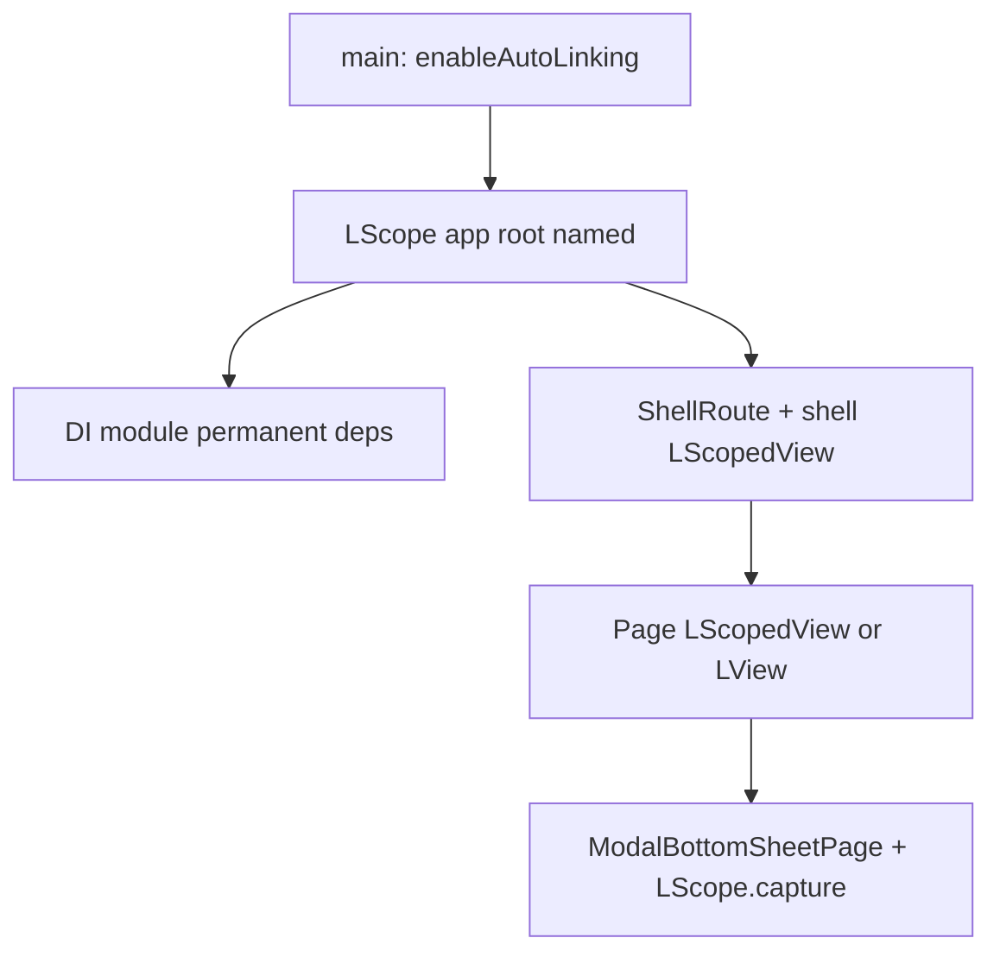

# Levit 0.0.9 — Improvement proposal (from Edaya mobile usage)

| Field | Value |
|---|---|
| Status | Proposal |
| Date | 22 July 2026 |
| Audience | Levit maintainers (target **0.0.9**) |
| Evidence base | Current usage in `edaya_mobile` on **`levit_flutter: ^0.0.8`** |
| Sources | `apps/guardian`, `apps/teacher`, `apps/guardian_prototype`, `packages/edaya_shared`, plus `spec/levit/` |

## Executive summary

Edaya’s Flutter monorepo is a real production-shaped consumer of Levit: three apps + a shared foundation, GoRouter shells, permanent app DI, page/sheet `LScopedView`s, widget/design-review harnesses, and Controllers that reload on context `LxVar` streams.

Levit’s ownership model fits this stack well. The gaps that show up at scale are mostly **defaults, diagnostics, and docs** — not missing core concepts. Version **0.0.9** should make the happy path quieter and the test/overlay path more obvious, without breaking the subclass + `onConfigScope` style Edaya already standardized on.

This proposal expands an earlier prototype-only note into a monorepo-wide backlog, ranked for 0.0.9.

---

## Inventory (approximate, July 2026)

| Signal | Count / finding |
|--------|-----------------|
| Packages on Levit | 4 (`guardian`, `teacher`, `guardian_prototype`, `edaya_shared`) — all `^0.0.8` |
| `LScopedView` subclasses | **~41** — all use `onConfigScope`; **0** set `scopeName` |
| `LView` subclasses / inlines | Teacher tabs + shared bootstrap/settings/account patterns |
| `LWatch(` in app code | **~69** |
| Top-level `return LWatch(...)` inside `LScopedView.buildView` | **~22** (plus nested partial watches) |
| Explicit `autoWatch: false` | **0** |
| `permanent: true` registrations | **~46** (modules + harnesses) |
| Soft / non-forced `reset` in product | **0** |
| `LScope.capture` call sites | **1** (`ModalBottomSheetPage`) |
| Raw `showModalBottomSheet` without capture | **≥2** (prototype student sheet; teacher attendance exception sheet) |
| `LRouteScope` / `LAsyncRouteScope` | **0** |
| `LxWorker` / `LxComputed` / `LevitStore` / tags / `lazyPutAsync` / `isFactory` | **0** in app code |
| `.stream.listen` on `LxVar` for reload side-effects | Widespread (~11 controllers, dozens of subscriptions) |
| Bare `Levit.find` in widgets | **0** (aligned); non-UI uses `EdayaRootScope.find` |

---

## Architectural patterns in use (canonical for Edaya)



### Two divergent app styles (both valid today)

| Style | Who | Lifetime of feature controllers |
|-------|-----|----------------------------------|
| **Page-scoped** | Guardian, guardian_prototype | `LScopedView` per route/sheet; `scope.put` in `onConfigScope` |
| **Root-permanent features** | Teacher | Many feature controllers registered `permanent: true` in module; tabs often `LView`; calendar also put into **shell** scope for tab survival |

0.0.9 should not force one style, but should **name and document both**, and make diagnostics work for nested unnamed scopes (guardian/prototype pain).

---

## Proposed 0.0.9 changes

### P0 — Nested scope default names (stop happy-path noise)

**Problem**  
`LScope` defaults `name` to `'LScope'`. Nested `LScopedView`s (shell → page → dialog) all create children named `"LScope"`, so `createScope` emits:

`Child scope "LScope" has the same name as ancestor scope "LScope"…`

on every navigation in debug/tests. Edaya has **41/41** `LScopedView`s with no `scopeName`.

**Evidence**  
Design-review / smoke logs in `guardian_prototype`; same nesting in `apps/guardian` (`AppShellPage` + feature pages).

**Proposal**
1. Default unnamed `LScopedView` scope name to something unique and useful, e.g.  
   - `LScopedView<HomeController>` or runtime type of the widget subclass (`HomePage`), optionally with identity suffix.
2. Optionally: only warn when a name was **explicitly** provided and collides; do not warn on framework defaults.
3. Align with `LRouteScope`’s better default (`route.settings.name ?? 'LRouteScope'`).

**Acceptance**  
Pumping shell + page `LScopedView` with no `scopeName` produces **no** duplicate-name warning.

---

### P0 — Fix or document `autoWatch` vs inner `LWatch`

**Problem**  
`LScopedView` / `LView` default `autoWatch: true` and wrap `buildView` in `LWatch`. Edaya (and LLM short examples) still write:

```dart
Widget buildView(...) {
  return LWatch(() { ... });
}
```

That yields a useless outer watch + an inner watch that does the real tracking. ~22+ pages do the top-level wrap; shared `LoginPage` / `AccountProfilePage` nest multiple `LWatch`s; **no** call site sets `autoWatch: false`.

**Proposal** (pick one primary, support the other as migration)
1. **Preferred API:** document subclass pattern as “read reactives directly in `buildView`; do not wrap in `LWatch` when `autoWatch` is true.” Update `spec/levit` / LLM examples accordingly.
2. **Preferred ergonomics:** if `buildView` returns an `LWatch`, skip the outer wrap (detect and flatten), or default `autoWatch: false` for the abstract subclass constructor while keeping `true` for `LScopedView.put` factory.
3. Optional analyzer/lint hint for nested `LWatch` under `autoWatch: true`.

**Acceptance**  
LLM short example and Edaya’s common subclass pattern agree; double-wrap is either unnecessary or automatically collapsed.

---

### P1 — `permanent` semantics clarity (+ optional soft reset)

**Problem**  
~46 `permanent: true` registrations. Product code never uses soft reset; tests use hard `Levit.reset()`. Authors treat `permanent` as “app singleton,” while the API means “survives non-forced reset.” Widget `dispose()` already `reset(force: true)`, so permanents do not leak across disposed scopes — but that is easy to misunderstand when writing harnesses.

Teacher further marks **feature** controllers permanent at root (evaluations, teaching, report cards), while guardian page-scopes them. Both work; the flag does not encode “feature vs app.”

**Proposal**
1. DartDoc: `permanent` protects against soft `reset`; **scope `dispose` always forces cleanup**.
2. Optional warning: `permanent: true` on a short-lived child widget scope (where dispose always forces) is a no-op for lifetime — consider documenting as root-scope intent only.
3. Consider a named soft-reset API for logout/test isolation that preserves root permanents without full `Levit.reset()` soup (only if you want product use; Edaya does not depend on it yet).

**Acceptance**  
A new consumer can answer “will this leak across widget tests?” from DartDoc alone.

---

### P1 — First-class widget-test helpers

**Problem**  
Each app reinvented harness patterns:

| App | Mount | Scope capture | Names | Tear-down |
|-----|-------|---------------|-------|-----------|
| Guardian / teacher | `LScope` + shell | `_scope = scope` in `dependencyFactory` | Fixed shared names | `Levit.reset()` after surface clear |
| Prototype | Same | Same | Unique via `identityHashCode` | Less systematic `Levit.reset` |

Friction: must pump before accessing scope; fixed names complicate concurrent/sequential pumps; permanent-heavy harness modules are hard to reason about.

**Proposal**
Ship a small test utility (e.g. `LevitTest` / `pumpLevitApp`) that:
1. Accepts `dependencyFactory` + child,
2. Returns `(tester, scope)` **after** first pump,
3. Documents tearDown (`dispose` / `Levit.reset`),
4. Defaults to unique scope names.

Optional: `binding` for `GoRouter` + `refreshListenable` recipe (Edaya uses `EdayaRouterRefresh` / `PrototypeRouterRefresh` everywhere).

**Acceptance**  
New app can write a widget test without copying a 100+ line harness for scope capture.

---

### P1 — Overlay / imperative sheet capture

**Problem**  
`LScope.capture` exists and is used correctly in `edaya_shared` `ModalBottomSheetPage` (routed sheets). Imperative `showModalBottomSheet` call sites often skip it (prototype student context sheet; teacher attendance exception sheet). Dialogs that are themselves `LScopedView` still need a parent scope in the overlay tree for `find` of app deps.

**Proposal**
1. Document capture as required for any overlay that must `context.levit.find` app deps.
2. Convenience wrappers: `showLevitModalBottomSheet`, `showLevitDialog` that capture by default.
3. Optional debug assert when `find` fails and the nearest overlay lacks a captured scope (actionable message).

**Acceptance**  
Imperative sheet recipe is one API call; routed and imperative paths behave the same for DI.

---

### P2 — Reactive side-effects (reduce `.stream.listen` glue)

**Problem**  
Controllers widely do:

```dart
autoDispose(contextVar.stream.listen((_) => unawaited(reload())));
```

across student/teacher context and academic year (~11 controllers). `LxWorker` exists but is unused. This is valid but verbose and easy to get wrong (missing dispose, duplicate reloads).

**Proposal**
1. Promote a first-class “effect” API (or document `LxWorker` as the reload recipe) with `autoDispose` integration on `LevitController`.
2. Optional: `controller.reactTo(lxVar, () => …)` sugar.

**Acceptance**  
LLM short docs show one recommended reload pattern; Edaya can migrate gradually.

---

### P2 — `Listenable` / GoRouter bridge recipe

**Problem**  
Every app bridges auth → GoRouter via a tiny `ChangeNotifier` (`EdayaRouterRefresh`, `PrototypeRouterRefresh`). Prototype also bridges `MockStore` → `LxVar storeTick` with `addListener`.

**Proposal**
Documented recipe or tiny helper:
- `LxVar` / auth flag → `Listenable` for `GoRouter.refreshListenable`
- `Listenable` → `LxVar` tick / bridge for hybrid migrations

Not mandatory in core if docs + example suffice.

---

### P2 — Route ownership story (`LRouteScope` vs shell patterns)

**Problem**  
`LRouteScope` is unused. Edaya uses GoRouter `ShellRoute` + shell `LScopedView` + page `LScopedView`/`LView`. Teacher additionally keeps calendar alive by putting it in the shell scope.

**Proposal**
Either:
1. Document the **shell + LScopedView/LView** pattern as first-class for GoRouter apps, or
2. Provide a GoRouter-oriented `LRouteScope` example that matches Edaya’s shell/tab survival needs.

Do not require a rewrite of Edaya for 0.0.9; clarify the recommended path so guardian vs teacher divergence is intentional.

---

### P3 — Kit adoption / unused surface

Unused in Edaya today: `LBuilder`, `LSelectorBuilder`, `LStatusBuilder`, `LKeepAlive`, `LevitStore`, tags, `lazyPutAsync`, `LScopedView.put` factory (subclass style preferred).

**Proposal**  
No API removal. Optionally call out in docs which kits are “page UI,” which are “DI sugar,” and that subclass + `onConfigScope` is a supported first-class style (Edaya’s 41× pattern).

---

## Docs / LLM guidance updates (ship with 0.0.9)

Update `LLM-Short` / `LLM.txt` (and package READMEs) to cover what Edaya actually needs:

| Topic | Current gap |
|-------|-------------|
| `autoWatch` | Not mentioned; examples encourage inner `LWatch` |
| `scopeName` on `LScopedView` | Not mentioned; defaults cause warnings |
| `permanent` vs `dispose` | Easy to misread |
| Widget tests | No pump/capture recipe |
| `LScope.capture` | Mentioned; imperative sheets underdocumented |
| GoRouter shell | `LRouteScope` pushed; shell pattern not documented |
| Page-scoped vs root-permanent features | No guidance; teacher vs guardian diverge |

Also sync Edaya’s `spec/levit/` copies when bumping the dependency.

---

## Suggested 0.0.9 slice (minimal vs nice)

**Must for 0.0.9**
1. P0 scope default names / warning policy  
2. P0 `autoWatch` + `LWatch` docs (and preferably API flatten)  
3. P1 `permanent` DartDoc  
4. P1 overlay capture docs + optional `showLevit*` helpers  

**Should**
5. P1 test pump helper  
6. P2 effect/`LxWorker` recipe  

**Could**
7. Listenable bridges  
8. GoRouter shell documentation / `LRouteScope` example  

---

## Non-goals for 0.0.9

- Forcing Edaya onto `LRouteScope` or a single lifetime style  
- Replacing Controllers with stores  
- Breaking the subclass + `onConfigScope` API  
- Solving form `StatefulWidget` / `TextEditingController` ownership (app concern; Cursor/Levit guidance already prefers controllers)

---

## How Edaya will consume 0.0.9

After bump:
1. Remove redundant top-level `LWatch` wrappers if API/docs make that the norm.  
2. Optionally set explicit `scopeName`s only where diagnostics matter (or rely on new defaults).  
3. Route imperative sheets through capture helpers.  
4. Adopt test helper in guardian/teacher/prototype harnesses.  
5. Optionally migrate `.stream.listen` reloads to the recommended effect API.

---

## Appendix A — Representative paths

| Concern | Paths |
|---------|--------|
| Named app roots | `apps/guardian/lib/app/guardian_app_root.dart`, `apps/teacher/lib/app/teacher_app_root.dart`, `packages/edaya_shared/lib/src/app/edaya_app_root.dart`, `apps/guardian_prototype/lib/app/prototype_app_root.dart` |
| Permanent modules | `apps/guardian/lib/di/guardian_module.dart`, `apps/teacher/lib/di/teacher_module.dart`, `packages/edaya_shared/lib/src/di/edaya_module.dart`, `apps/guardian_prototype/lib/di/prototype_module.dart` |
| Capture (good) | `packages/edaya_shared/lib/src/common/models/modal_bottom_sheet_page.dart` |
| Capture gaps | `apps/guardian_prototype/lib/app/shell_page.dart`, `apps/teacher/lib/features/session/attendance_exception_sheet.dart` |
| Double `LWatch` | e.g. `apps/guardian/lib/features/calendar/calendar_page.dart`, prototype feature pages, `packages/edaya_shared/.../login_page.dart` |
| Stream reload glue | e.g. `apps/guardian/lib/features/fees/fees_controller.dart`, `apps/teacher/lib/features/calendar/calendar_controller.dart` |
| Router refresh | `packages/edaya_shared/lib/src/app/router_refresh.dart` |
| Test harnesses | `apps/guardian/test/integration/support/guardian_widget_test_harness.dart`, `apps/teacher/test/integration/support/teacher_widget_test_harness.dart`, `apps/guardian_prototype/test/integration/support/prototype_widget_test_harness.dart` |
| Spec | `spec/levit/LLM-Short.txt`, `spec/levit/LLM.txt`, `spec/levit/AGENTS.md` |

## Appendix B — Origin of this proposal

Initial feedback came from adopting Levit in `apps/guardian_prototype` (nested `"LScope"` warnings; test scope capture; `permanent` confusion). This document expands that feedback with a full survey of guardian, teacher, and `edaya_shared` usage so 0.0.9 prioritizes issues that appear in production-shaped apps, not only the prototype.
