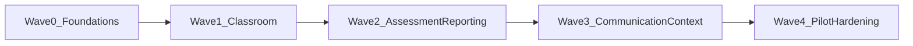

# Teacher app — Implementation plan

**Status:** Active  
**Date:** 2026-07-19  
**Source:** [Teacher app improvement proposal](../proposals/teacher-app-improvement-proposal.md)

## Current baseline

The teacher app is a working proof of concept with a credible foundation:

- **4 bottom-nav tabs:** Calendar, Evaluations, Teaching, Report cards
- **Core flows:** weekly timetable, session detail, sequential attendance, session logbook (note + curriculum progress), evaluations, marks entry, teaching progress, report-card class summaries and student roster
- **Platform:** English and French, light/dark theme, push registration, Levit + go_router, typed API client
- **Quality:** `flutter analyze` clean; 38 default tests pass (live API integration suite skipped unless configured)

**Principal gaps** (blocking commercial promise):

| Gap | Code location |
|-----|---------------|
| Broken notification deep links | `apps/teacher/lib/navigation/notification_navigation.dart`, `packages/edaya_shared/lib/src/features/push/push_notifications.dart` |
| Report-card comments read-only | `apps/teacher/lib/features/report_cards/report_card_roster_sheet.dart` (icon, no `onTap`) |
| Silent assessment scheduling defaults | `packages/edaya_shared/lib/src/api/evaluation_data.dart` (`buildInClassAssessmentTiming`, `createAssessmentPayload`) |
| Per-student marks dialog | `apps/teacher/lib/features/evaluations/marks_entry_sheet.dart` (`_editScore` → `showDialog`) |
| No teacher inbox | Guardian reference: `apps/guardian/lib/features/inbox/` |
| No offline outbox | All writes are immediate API calls |
| Dev credentials in release path | `apps/teacher/lib/config/api_config.dart`, `apps/teacher/lib/app/router.dart` |

## Locked decisions

| # | Decision | Status |
|---|----------|--------|
| 1 | **4 bottom-nav tabs** for v1: Calendar, Evaluations, Teaching, Report cards (evolve before 5-tab redesign) | Locked |
| 2 | **Empty states:** show all assigned classes/subjects even when no data | Locked |
| 3 | **Report-card comments:** homeroom `teacherComment` + subject section `comment`, gated by capabilities | Locked |
| 4 | **Teaching filters:** independent from global calendar class filter | Locked |
| 5 | **Navigation IA:** evolve 4-tab first; Inbox via app-bar action until pilot | Recommended — pending product sign-off |
| 6 | **Offline conflict:** last-write-wins with server version check | Recommended — pending product sign-off |
| 7 | **Mobile report-card scope:** comment-only unless explicit publish capability | Recommended — pending product sign-off |

## Workflow maturity

| Workflow | Maturity | Principal limitation | Code location |
|----------|----------|----------------------|---------------|
| Authentication | Proof of concept | Password-only UI; dev credentials visible | `apps/teacher/lib/app/router.dart` |
| Calendar | Functional | Browsing-oriented; no Today / incomplete-task priority | `apps/teacher/lib/features/calendar/` |
| Attendance | Functional | No mark-all-present, reasons, justification, offline | `apps/teacher/lib/features/session/attendance_flow_page.dart` |
| Session logbook | Partial | Note + curriculum % only | `apps/teacher/lib/features/session/` |
| Teaching progress | Functional read | Limited planning and follow-up | `apps/teacher/lib/features/teaching/` |
| Evaluations | Partial | Missing dates, coefficient, instructions, lifecycle | `apps/teacher/lib/features/evaluations/` |
| Marks | Functional, inefficient | One dialog + network write per student | `apps/teacher/lib/features/evaluations/marks_entry_sheet.dart` |
| Report cards | Partial / read-only | No comment editor | `apps/teacher/lib/features/report_cards/` |
| Notifications | Infrastructure only | No inbox; some routes undefined | `apps/teacher/lib/navigation/notification_navigation.dart` |
| Student context | Missing | No class roster or quick profile | — |
| Homework | Partial data model | `homework` kind only; no submission UI | — |
| Offline | Missing | Classroom writes need connectivity | — |
| Tablet | Unproven | Phone-oriented layouts | — |

## Delivery waves



---

## Sprint 1 — Immediate (2 weeks)

Concrete slice across Wave 0 and Wave 2:

| Story | Wave | Pts | Acceptance |
|-------|------|-----|------------|
| Fix teacher notification routing + tests | 0 | 3 | All FCM payloads resolve or fallback safely; no route errors | Done |
| Gate dev credentials behind debug/internal flavor | 0 | 2 | Release build shows empty login form | Done |
| Report-card comment sheet | 2 | 5 | Tap student → edit homeroom/subject comment → save → icon updates | Done |
| Assessment form: require explicit date fields | 2 | 3 | No silent 09:00 default; validation errors shown | Done |
| Inline marks entry (no per-student dialog) | 2 | 5 | Grade a class without opening a modal per student | Done |

---

## Wave 0 — Foundations (1–2 sprints)

**Scope:** Production safety, notification repair, deep-link architecture, offline design, shared UI tokens.

- [x] Gate dev credentials and API URL switching behind debug/internal flavor — `apps/teacher/lib/config/api_config.dart`, shared `LoginPage`
- [x] Teacher notification registry + safe fallbacks — `apps/teacher/lib/navigation/notification_navigation.dart`
- [x] Identifier-based deep links for session / assessment / message routes — `apps/teacher/lib/navigation/teacher_route_paths.dart`, `teacher_entity_resolvers.dart`, `teacher_route_loaders.dart`, `apps/teacher/lib/app/router.dart`
- [x] Offline/outbox architecture spike (package choice, idempotency keys) — [teacher-offline-outbox-spec.md](./teacher-offline-outbox-spec.md)
- [x] Aggregate teacher-workspace API design (backend RFC) — [teacher-workspace-api-rfc.md](./teacher-workspace-api-rfc.md)
- [x] Shared teacher UI tokens in `edaya_shared` (SessionCard, SyncIndicator, StatusBadge) — `packages/edaya_shared/lib/src/ui/`
- [x] Notification routing tests — `apps/teacher/test/teacher_notification_targets_test.dart`

**Backend dependencies:** aggregate agenda, evaluation summary, report-card summary, Today action queries (RFC only in this wave).

**Exit gate:** No invalid push destinations; no seeded credentials in release builds; outbox spec approved.

---

## Wave 1 — Daily classroom workflow (2–3 sprints)

**Scope:** Faster attendance, structured logbook, draft autosave, initial offline writes.

- [x] Today segment on Calendar (current/next session, incomplete task chips) — `calendar_today_logic.dart`, `calendar_today_segment.dart`
- [x] Mark-all-present attendance + exception form — `attendance_flow_page.dart`, `attendance_exception_sheet.dart`
- [x] Attendance reasons/notes in payload — `packages/edaya_shared/lib/src/api/attendance_data.dart`
- [x] Structured logbook v1 — `session_details_sheet.dart`, `session_logbook_logic.dart` (objectives, homework, family summary via JSON envelope in `sessionNote`)
- [x] Logbook draft autosave — `session_logbook_draft_storage.dart`
- [x] Attendance + logbook outbox — `packages/edaya_shared/lib/src/offline/`, `teacher_outbox_sync.dart`
- [ ] Session attachments v1 (deferred — no `lesson_session` attachment owner kind on API)

**Backend dependencies:** confirm attendance reason/notes fields; logbook schema for content, objectives, homework, family-visible summary.

**Exit gate:** 30-student attendance under 90 seconds; logbook survives app restart; pending writes visible.

---

## Wave 2 — Assessment and reporting (2–3 sprints)

**Scope:** Complete assessment lifecycle, efficient marks, report-card comments.

- [x] Full-page assessment create/edit — `evaluation_create_sheet.dart` (date fields + lifecycle menu; full-page route optional follow-up)
- [x] Remove silent scheduling defaults — `packages/edaya_shared/lib/src/api/evaluation_data.dart` (UI now requires explicit dates)
- [x] Assessment lifecycle actions (duplicate, complete) — `evaluations_page.dart`, `evaluations_controller.dart`
- [x] Inline marks entry — `marks_entry_sheet.dart`
- [x] Bulk fill/clear, ungraded filter, per-row sync state — `marks_entry_sheet.dart`, `mark_row_tile.dart`
- [x] Marks outbox — `evaluations_controller.dart`, `teacher_outbox_sync.dart`
- [x] Report-card comment sheet — homeroom + subject sections; `report_card_roster_sheet.dart`
- [x] Comment draft autosave + outbox — `report_card_comment_draft_storage.dart`, `report_card_comment_controller.dart`
- [x] Tablet marks grid (≥600dp) — `marks_entry_sheet.dart`

**Exit gate:** Full assessment-to-report-card loop without web; published locks enforced and explained.

---

## Wave 3 — Communication and student context (2–3 sprints)

**Scope:** Inbox, class workspace, student quick profile, homework tracking, resources.

- [ ] Teacher inbox — port from `apps/guardian/lib/features/inbox/`
- [ ] Routes `/inbox`, `/inbox/message` in `apps/teacher/lib/app/router.dart`
- [ ] Notification preferences in account/settings
- [ ] Class workspace (roster, attendance history, teaching entry)
- [ ] Student quick profile (capability-gated)
- [ ] Homework tracking (submission states)
- [ ] Resource library + attachments

**Backend dependencies:** homework submission contract; student notes/incidents APIs; resource upload/download capabilities.

**Exit gate:** Every notification opens a valid teacher destination; student context without admin modules.

---

## Wave 4 — Pilot hardening (1–2 sprints + pilot)

**Scope:** Performance, accessibility, tablet layouts, observability, store readiness.

- [x] Replace N+1 API loops — batch `assessmentResults` per class-subject in `evaluations_controller.dart`
- [x] Accessibility audit (200% text, semantics, contrast, FR layouts) — sync indicators + semantics on shared widgets; full audit checklist in store release doc
- [x] Tablet `NavigationRail` master-detail scaffolds — `app_shell_page.dart`
- [x] Observability (screen load, outbox age, deep-link failures) — `teacher_observability.dart`
- [x] Integration tests — `teacher_screens_integration_test.dart`, `teacher_routes_integration_test.dart`
- [x] Store release checklist — `docs/sprints/teacher-store-release-checklist.md`

**Exit gate:** Pilot metrics met; no known data-loss paths; security and accessibility checklists pass.

---

## Screen journeys

### Calendar and session (`/calendar`)

```
Calendar tab
  → Week day selector + class filter
  → Session list tiles
  → Session detail sheet (attendance tab | logbook tab)
  → Optional: full-screen attendance flow
```

**Data reads:** class timetables, lesson/activity sessions, enrollments, students, attendance, lesson session progress.

**Writes:** `recordAttendance`, `lessonSessions.save`, `recordLessonSessionProgress`, `classSubjectProgress.save`.

**Phases:**

- [x] P1 — Weekly calendar, session tiles, session detail sheet
- [x] P2 — Sequential attendance flow
- [x] P3 — Today segment, completion chips on session cards
- [x] P4 — Mark-all-present attendance, reasons, offline outbox (initial SharedPrefs store)

### Evaluations and marks (`/evaluations`)

```
Evaluations tab
  → Academic period picker
  → Evaluation list (per assigned class/subject)
  → Create evaluation
  → Marks entry sheet
```

**Data reads:** `academicPeriods`, `assessments`, `assessmentResults`, `enrollments`, `students`, `results` (publish lock).

**Writes:** `createAssessment`, `recordAssessmentResult`.

**Phases:**

- [x] P1 — List, period picker, create (basic fields)
- [x] P2 — Marks entry with publish lock
- [x] P3 — Full assessment form (dates; coefficient/description follow-up)
- [x] P4 — Inline marks, bulk actions, marks outbox

### Teaching (`/teaching`)

```
Teaching tab
  → Pick class (assigned classes)
  → Pick subject (accessible class-subjects for that class)
  → Tab [Progress] | [Logbook]
       Progress: class-subject aggregate + matter breakdown
       Logbook: lesson sessions for subject → tap opens session detail sheet
```

**Data reads:**

| Entity | Filter |
|--------|--------|
| `classSubjects` | Selected `classSubjectId` |
| `classSubjectMatters` | `{ classSubjectId }` |
| `subjectMatters` | By ids from matters |
| `lessonSessions` | `{ classGroupId, classSubjectId }` |
| `classSubjectProgress` | `progressForLessonSessions(sessionIds)` |

**Writes:** none (navigate to calendar session detail for edits).

**Phases:**

- [x] P1 — Shell tab, routes, scope pickers, Progress tab
- [x] P2 — Logbook tab + session navigation
- [x] P3 — Integration tests (read probes) — `teacher_routes_integration_test.dart`
- [ ] P4 — Polish (filter sheet optional)

### Report cards (`/report-cards`)

```
Report cards tab
  → Academic period picker
  → Class list (all assigned classes, empty state if no generated results)
  → Student roster with draft results
  → Comment sheet (homeroom + subject sections per capability)
```

**Data reads:**

| Entity | Filter |
|--------|--------|
| `results` | `reportCardResultsForClassPeriod(classGroupId, periodId)` |
| `definitions`, `sections` | For labels and writable sections |
| `students` | Class roster |

**Write:** `results.save` with comment-only diff (`teacherComment`, section `comment`).

**Phases:**

- [x] P1 — Tab, period picker, class list with counts / empty states
- [x] P2 — Student roster (draft results, averages, rank, comment presence)
- [x] P3 — Comment sheet (homeroom + subject capabilities)
- [x] P4 — Integration tests + publish lock UX — route integration suite; publish lock hints on marks sheet

### Inbox (planned)

```
App bar inbox action (until dedicated tab)
  → Message list (unread badge, filters)
  → Message detail
  → Deep link to session, assessment, student, or report card (with fallback)
```

**Data reads:** `messageDeliveries` (filtered for teacher actor).

**Writes:** mark read/unread; `update-notification-contact` for preferences.

**Phases:**

- [ ] P1 — Port guardian inbox; teacher routes
- [ ] P2 — Notification registry integration + cold-start handling
- [ ] P3 — Filters, preferences, unread sync across devices

---

## Success measures

### Product

- Median time to complete attendance (target: &lt;90s for 30 students with mark-all-present)
- Percentage of sessions with attendance completed within 15 minutes
- Percentage of session logbooks completed same day
- Median time to grade a class
- Report-card comment completion rate
- Notification open-to-valid-destination rate

### Reliability

- Crash-free sessions
- P95 warm screen-load time
- Offline write success rate
- Outbox retry rate and age of oldest unsynchronized operation
- Failed deep-link rate
- Support requests per 100 active teachers

### Guardrails

- Zero silent data loss
- Zero unauthorized student or health-record access
- Zero invalid production notification destinations
- No accidental publication or editing of locked records
- No production exposure of API switching or seeded credentials
- No sensitive tokens or student content in logs or analytics

---

## References

### Mobile

- Teacher app: `apps/teacher/lib/`
- Shared API helpers: `packages/edaya_shared/lib/src/api/`
- Guardian inbox (port source): `apps/guardian/lib/features/inbox/`
- Integration tests: `apps/teacher/test/integration/`, `tooling/integration_tests/`

### Web (data mapping reference)

- `edaya_web/apps/webapp/src/lib/api/teaching-log-data.ts`
- `edaya_web/apps/webapp/src/lib/api/report-cards-data.ts`
- `edaya_web/apps/webapp/src/lib/api/session-detail-data.ts`
- `edaya_web/apps/webapp/src/lib/api/homework-data.ts`

### Product and backend

- [Teacher app improvement proposal](../proposals/teacher-app-improvement-proposal.md)
- Backend: `report-card-comment-access.ts`, `session-content-model-plan.md`
